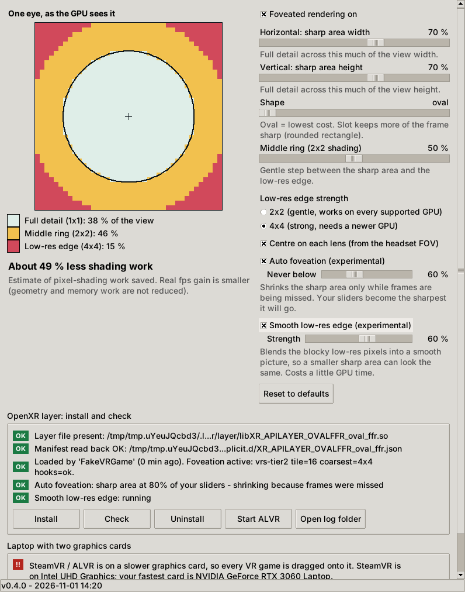
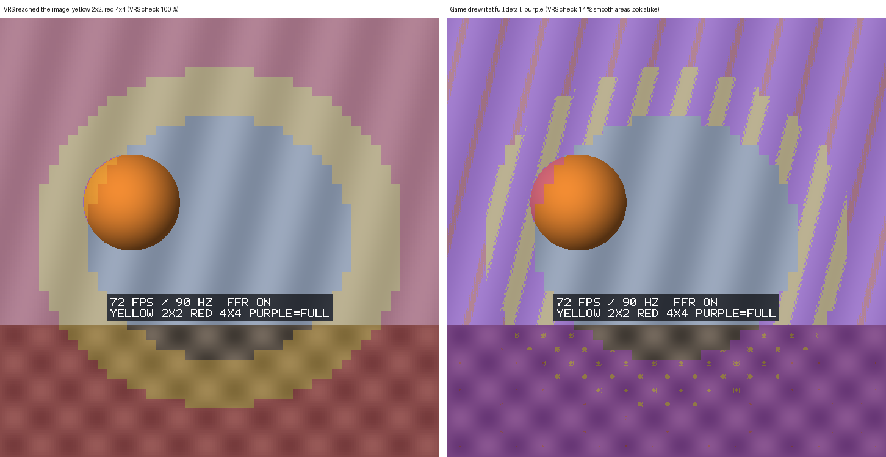
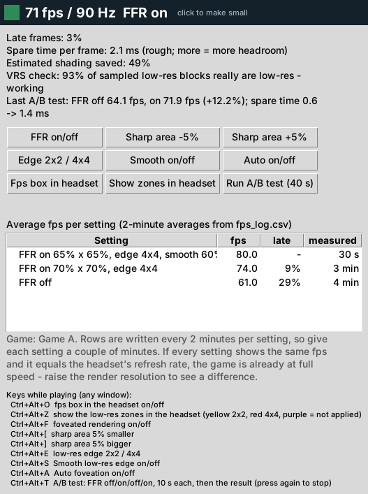
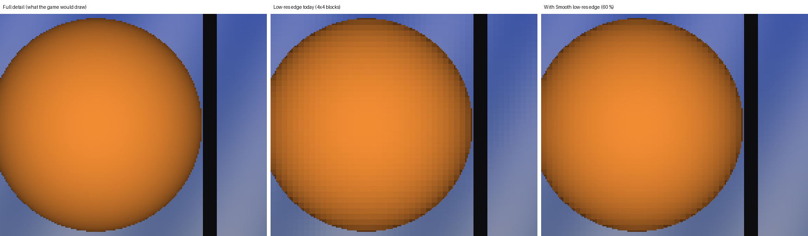

# OvalFFR

**Oval/slot fixed foveated rendering for OpenXR VR games, with a control panel. Built to cut GPU load for games streamed through ALVR.**

> **Work in progress (v0.5.0).** The control panel, the OpenXR layer plumbing and the Direct3D 12 code are in place, but the Direct3D 12 part (the foveation itself, *Smooth low-res edge*, and the new in-headset fps box, zone highlight and VRS check) has **not yet been run in a real game or on a GPU**, and the dual-GPU fix has never touched a real Windows registry. Direct3D 11 and Vulkan are not implemented. Read [What works and what is untested](#what-works-and-what-is-untested) before relying on it.



*The screenshot uses simulated test data (a fake game report saying SteamVR is on the integrated card, Auto shrinking and smoothing running). Auto foveation and Smooth low-res edge are ticked here to show their status rows; both are **off by default**. No real game, headset or GPU was involved.*

## What it does

Variable Rate Shading lets the GPU shade a block of pixels once instead of once per pixel. OvalFFR keeps a sharp **oval (or slot) in the middle** of each eye's image and shades the rest more coarsely:

| Zone | Shading | Where |
|---|---|---|
| Full detail | 1x1 | inside the oval/slot |
| Middle ring | 2x2 | a gentle step around it |
| Low-res edge | 2x2 or 4x4 | everything else, **including the corners**, which the lens barely shows |

The oval is centred on each lens from the headset's field of view. The panel's **Horizontal** and **Vertical** sliders set the sharp area's width and height, and the picture shows exactly which part of the view is low-res. The default setting is estimated to cut pixel-shading work by about **49 %** (a unit test keeps it at 10 % or more); real fps gain is smaller, because geometry and memory work are not reduced.

**Why not just use ALVR's foveated encoding?** That compresses the frame *after* the game has rendered it, to save Wi-Fi bandwidth. It does not reduce the game's GPU work. OvalFFR reduces the rendering itself.

## Quick start (click and launch)

1. Double-click the launcher for your system:
   - Windows: `OvalFFR-Windows.bat`
   - Linux: `OvalFFR-Linux.sh` (choose "Run")
   - Mac: `OvalFFR-Mac.command` (first time: right-click, Open)
2. Press **Install**. The panel installs the layer and reads it back to confirm.
3. Start your game through ALVR as usual.
4. Press **Check**. It should say the layer was loaded by your game and that foveation is **active**. If it says *pass-through*, the reason is shown (for example "app does not use D3D12").
5. Move the sliders while playing. Changes apply within about a second. **Uninstall** removes everything.

Needs Python 3.8+ with tkinter (included with the python.org installers; Linux: `sudo apt install python3-tk`). Without tkinter the launchers fall back to text mode.

## Is it doing anything? (fps box, zones, A/B test)

New in 0.5.0, because "is it actually working?" is the first thing to find out.

**In the headset** (also visible in the SteamVR mirror window on the PC). Keys work from any window, as long as the VR game has focus in the headset:

| Keys | What it does |
|---|---|
| **Ctrl+Alt+O** | small fps box under the lens centre: `72 FPS / 90 HZ  FFR ON`, and below it the estimated saving and the VRS check |
| **Ctrl+Alt+Z** | **show the zones**: yellow = 2x2, red = 4x4, **purple = OvalFFR asked for low-res but the image the headset gets is full detail there** (VRS did not reach it) |
| **Ctrl+Alt+F** | foveated rendering on/off (quick before/after) |
| **Ctrl+Alt+[** / **]** | sharp area 5% smaller / bigger |
| **Ctrl+Alt+E** | low-res edge 2x2 / 4x4 |
| **Ctrl+Alt+S** / **A** | Smooth low-res edge / Auto foveation on/off |
| **Ctrl+Alt+T** | **A/B test**: FFR off, on, off, on, 10 s each (first 3 s of each ignored), then shows e.g. `A/B: OFF 64 ON 72 FPS +12%`. Press again to stop |

Every key press shows what changed for 3 seconds. Setting changes are saved, so the panel follows them. Ctrl+Alt is AltGr on UK/European keyboards, so avoid typing AltGr+letter in other programs while a VR game runs.



*The C++ copy of the shader on a made-up scene. Not a game or a headset.*

**The VRS check** answers "is it doing anything?" directly. While the zones or Smooth low-res edge are on, the layer looks at one low-res block in every 16x16 pixels of the image the headset gets and counts how many are exact copies (what VRS produces).
- About **90 % or more** means VRS really reaches the picture.
- **Near 0 %** (lots of purple) means the game draws that image at full detail. Usually that's because it renders into its own buffer and post-processes before handing the image over. VRS may still save work in the game's own buffer in that case, but OvalFFR cannot see that, and the fps numbers are the judge.
- Flat single-colour areas look the same either way, so the figure is never exactly 0 %.

**On the desktop:** the panel's **Mini fps window** button opens a small always-on-top box with the live fps. Click it for more: late frames, spare time, the VRS check, buttons for every setting, *Show zones in headset*, *Run A/B test*, and the table of fps per setting.



**The fps log** (`fps_log.csv` in the settings folder) gets **one row per setting, averaged over 2 minutes**, plus a row whenever you change the setting after at least 20 s. Loading screens are left out, and the A/B test writes its own two rows. Text mode: `--cli fps` prints the per-setting table, and `--cli fps send zones` sends a command.

**If every setting gives the same fps and it equals the headset's refresh rate**, the game already runs at full speed and fps cannot rise. FFR then only buys headroom (the "spare time" figure, a rough measure). To see a difference, raise the render resolution in ALVR or SteamVR until the fps drops, then compare.

## What works and what is untested

| Part | Status |
|---|---|
| Mask maths (oval/slot, 3 zones, savings estimate, lens centring) | Unit-tested on Linux |
| OpenXR layer: negotiation, hooks, config hot reload, status/log | Tested on Linux against a **fake** OpenXR runtime (mock backend) |
| Python preview equals the C++ mask | Tested (`tests/test_mask_parity.py`) |
| Control panel | Run on Linux under a virtual display; screenshot above |
| Installer (files, manifest, read-back, uninstall) | Tested on Linux in a throw-away home folder |
| Edge cases (odd configs, NaN, huge sizes, FOV jitter, quad views, overlay apps) | Tested on Linux, including fuzzing and AddressSanitizer/UBSan. See [docs/EDGE_CASES.md](docs/EDGE_CASES.md) |
| Auto foveation: decision logic (simulated games) and layer wiring (fake runtime, closed loop) | Tested on Linux. **Not run in a real game; no fps measured** |
| Smooth low-res edge: the maths (a line-by-line C++ copy of the shader) and the layer wiring (fake runtime) | Tested on Linux. The shader passes the Khronos HLSL front end (glslang), **not** Microsoft's compiler. **Never run on a GPU; cost not measured** |
| fps box, zone highlight, VRS check (C++ copy of the shader), live fps, fps log, commands, focus handling, A/B test (fake runtime) | Tested on Linux. **The D3D12 drawing and the Ctrl+Alt keys (Windows only) have never run** |
| Mini fps window, panel following outside changes | Run on Linux under a virtual display (self-test + screenshot) |
| Dual-GPU: verdict logic, registry logic with undo | Tested on Linux with an in-memory stand-in for the registry |
| Dual-GPU: the real Windows registry write and the real graphics-card enumeration | **Not run** (Windows-only code, never executed) |
| Linux wrapper script for laptops with two GPUs | Run with fake `lspci` output; **never on a real hybrid laptop** |
| Windows layer DLL | **Cross-compiled** with mingw-w64; exports checked; **never loaded by a real OpenXR loader** |
| Windows registry install | **Not run** (written from the OpenXR loader documentation) |
| Direct3D 12 VRS backend | **Compile-checked only**; vtable slots verified by static asserts; not run on a GPU |
| Direct3D 11, Vulkan | **Not implemented** (the layer reports pass-through). Effort estimate for Linux/Vulkan: [docs/LINUX_VULKAN_PLAN.md](docs/LINUX_VULKAN_PLAN.md) |
| macOS, Windows launchers | Not run (Linux launcher was run for real) |
| Real games, real fps numbers, ALVR end to end | **Not tested** |
| Low-end check (7th gen Core i3) | Not run. The app has no GPU requirement; the layer is a pass-through without VRS tier 2 |

### Known limits

- GPU needs **Variable Rate Shading tier 2** (NVIDIA GTX 16 / RTX 20 or newer, AMD RX 6000 or newer, Intel Arc/Xe). Without it nothing changes and nothing breaks.
- Only games that use OpenXR **with Direct3D 12**. OpenVR-only games are not seen by an OpenXR layer.
- Games that create their render targets *before* starting the OpenXR session, or move descriptors with `CopyDescriptors`, may show no effect.
- A game with its own dynamic resolution may spend the saved time on a sharper picture instead of more fps. Pin its resolution when comparing.
- Fixed foveation is easier to notice than eye-tracked foveation. If you see the edge, raise the sliders or the ring.

Details and sources: [docs/RESEARCH_NOTES.md](docs/RESEARCH_NOTES.md). How it is built: [docs/ARCHITECTURE.md](docs/ARCHITECTURE.md).

## Auto foveation (experimental, off by default)

Tick **Auto foveation (experimental)**. Your sliders then become the *sharpest* the oval will go. If the game keeps missing display refreshes, the layer shrinks the sharp area in small, slow steps down to the floor you set; when frames are fine again it grows back. If shrinking does not help (the game is limited by the CPU or the network, not the GPU) it gives the quality back and stops trying for a while. The panel shows the live percentage. Text mode: `--cli set auto=1 auto_floor=50`.

Honest limits: the decision logic and a closed-loop run against a fake runtime are tested; it has **not** been run in a real game and **no fps gain has been measured**. It judges by `xrWaitFrame` timing, and I do not know yet how SteamVR/ALVR pacing looks to it. Other speed-up ideas that were researched and **not** built (peripheral frame generation, ...) are explained in [docs/PERF_IDEAS.md](docs/PERF_IDEAS.md).

## Smooth low-res edge (experimental, off by default)

The low-res edge looks blocky because Variable Rate Shading shades one colour per 2x2 or 4x4 block and copies it to every pixel of the block. Tick **Smooth low-res edge (experimental)** and, after the game has drawn each eye, a small extra GPU pass blends those blocks into a smooth picture, like stretching a small image with bilinear filtering instead of nearest-neighbour. The idea: if the edge no longer *looks* low-res, you can afford a **smaller sharp area or the stronger 4x4 edge**. That is where the extra fps comes from. The smoothing itself saves nothing and costs a little.



*Made by the C++ copy of the shader on a synthetic scene, magnified 3x. Not a screenshot from a game or a GPU.*

What it will and will not touch:

- The **sharp area is never written**.
- It only changes a block whose pixels are all identical copies. Blocks with an object's outline running through them, film grain or other real detail are left alone. If a game draws into its own buffer and post-processes before handing the image over, the blocks are no longer exact copies, so the pass changes nothing there (and still costs its time).
- Neighbouring blocks with clearly different colour count as an edge and are not blended in.
- **Strength** (0-100%) sets how far each pixel moves towards the smooth version.
- Text mode: `--cli set smooth=1 smooth_strength=60`. The panel's status area shows *Smooth low-res edge: running*, or why it is unavailable (for example no `d3dcompiler_47.dll`). Any failure switches off only the smoothing, never the game.

Measured on synthetic images (not hardware): the difference to the full-detail picture in the low-res zones drops by **88 %** on a soft wavy scene and a lit ball scene. Outlines move by at most 0.005 (on a 0-1 scale). A full-detail image is left 100% unchanged (noise) or 99.99% unchanged (smooth scene).

**Cost: not measured.** It copies each eye image once and runs one full-screen pass. My rough estimate is about 150 MB of memory traffic per frame for two 2000x2000 eyes, which I'd guess at roughly 0.3-0.5 ms on a mid-range card. Treat that as a guess until it is measured. The shader is compiled the first time it is needed, which may cause one short hitch.

## Laptops with two graphics cards

On a laptop with an integrated and a gaming GPU, the **VR runtime (SteamVR, which hosts ALVR) decides which card every OpenXR game must use**. Forcing only the game does not help if SteamVR itself started on the integrated chip. So OvalFFR does two things:

1. **Detects it.** When a game starts, the layer compares the card the runtime picked with the fastest card Windows reports, and the panel shows a green or red line in the *Laptop with two graphics cards* box (also in `status-<pid>.txt` as `gpu_verdict`).
2. **Fixes it (Windows).** *Use gaming GPU for SteamVR* sets Windows' own per-program "High performance" preference (the same switch as Settings > System > Display > Graphics) for the SteamVR and ALVR programs it finds, after you confirm the list. It reads every change back, remembers what was there before, and **Undo GPU changes** puts it all back exactly. *Add program...* does the same for any `.exe` (for example the game). Restart SteamVR afterwards.

Text mode: `python3 src/main.py --cli gpu status`, `gpu force`, `gpu add C:\path\game.exe`, `gpu undo`.

**Linux:** nothing is written to your system. Start ALVR or SteamVR through `tools/ovalffr-gpu-linux.sh`, for example `./tools/ovalffr-gpu-linux.sh alvr_dashboard`. It looks at your graphics cards and, for that one launch only, sets NVIDIA's PRIME offload variables (`__NV_PRIME_RENDER_OFFLOAD=1`, `__VK_LAYER_NV_optimus=NVIDIA_only`) or Mesa's `DRI_PRIME=1`. `--list` shows what it found, `--dry-run` shows the command. Flatpak programs need `flatpak override` instead (the script header has the command).

Honest limits: only `vrserver.exe` is backed by a user report that this fixed a wrong-card problem; the other SteamVR programs are the same family but not individually confirmed. NVIDIA's and AMD's own control panels also have per-program settings, and I did not find out which one wins. None of this has been run on a real laptop.

## Settings

| Control | Meaning |
|---|---|
| Foveated rendering on | Master switch. Off = the layer does nothing. |
| Horizontal / Vertical | Size of the full-detail area as a % of the view width / height (20-100). With Auto on, this is the largest it will be. |
| Shape | Oval (lowest cost) to slot (rounded rectangle, keeps more of the frame sharp). |
| Middle ring | Thickness of the 2x2 step around the sharp area. |
| Low-res edge strength | 2x2 gentle, or 4x4 strong (needs a GPU that supports it; otherwise 2x2 is used). |
| Centre on each lens | Use the headset's field of view to find each lens axis. |
| Auto / Never below | Auto foveation on/off, and the smallest the sharp area may shrink to (40-100% of your sliders). |
| Smooth low-res edge / Strength | Blend the blocky low-res pixels after the game draws (off by default), and how strongly (0-100%). |
| Show fps in the headset | The small fps box (Ctrl+Alt+O). Off by default. |

The settings live in `config.ini` (Windows `%LOCALAPPDATA%\OvalFFR`, Linux `~/.config/ovalffr`, Mac `~/Library/Application Support/OvalFFR`). The layer writes one `status-<process id>.txt` per VR program that loads it, and `layer.log`, there too.

Text mode: `python3 src/main.py --cli show`, `--cli set h=60 v=45`, `--cli install`, `--cli status`, `--cli fps`. The mini window on its own: `python3 src/main.py --mini`.

## Build and test

```sh
cmake -S layer -B build -DCMAKE_BUILD_TYPE=Release && cmake --build build -j
./build/core_test
./build/fuzz_test
./build/smooth_test
./build/layer_test ./build/libXR_APILAYER_OVALFFR_oval_ffr.so "$(mktemp -d)"
OVALFFR_BUILD=$PWD/build python3 -m unittest discover -s tests -v
```

Windows DLL on Linux: configure with a mingw-w64 toolchain (the vendored Microsoft headers are used automatically). The prebuilt DLL and Linux layer in `prebuilt/` were made this way. Check the vtable slots with `tests/check_d3d12_vtable.c` (command inside the file).

## Licence

[PolyForm Noncommercial License 1.0.0](LICENSE.md): source-available, free for noncommercial use. Third-party headers are listed in [THIRD_PARTY_NOTICES.md](THIRD_PARTY_NOTICES.md).

Author: Matthew Armstrong. Changelog: [CHANGELOG.md](CHANGELOG.md). Contributing: [CONTRIBUTING.md](CONTRIBUTING.md).
