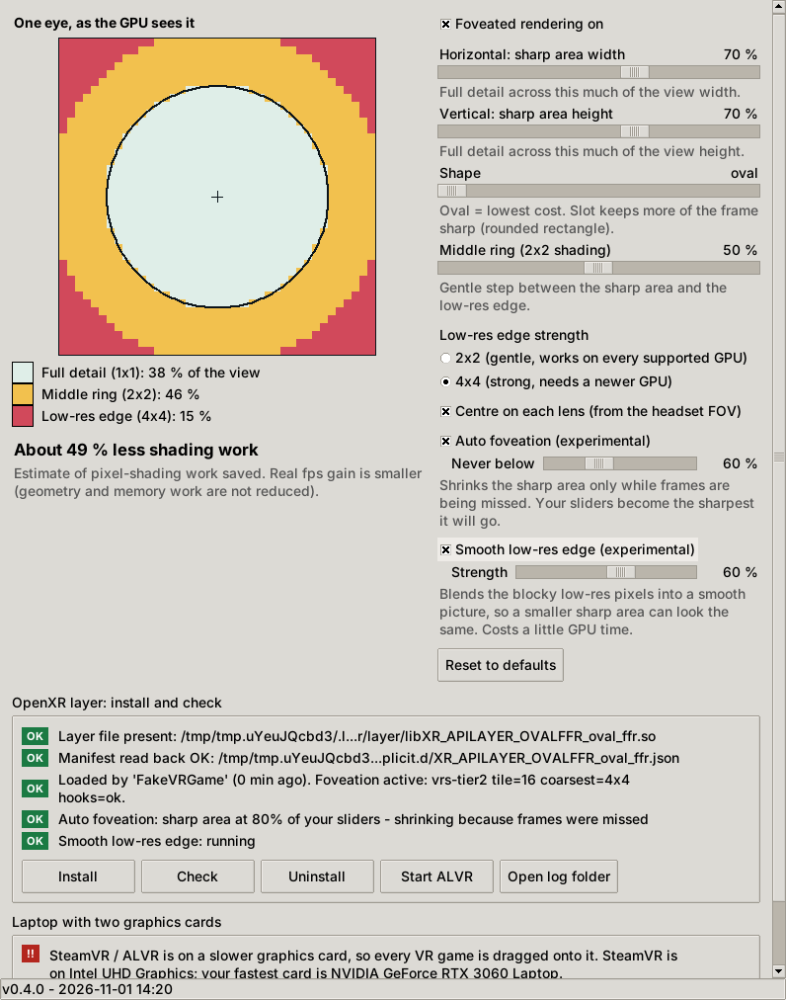

# OvalFFR

Oval/slot **fixed foveated rendering** for OpenXR VR games, with a control panel: horizontal and vertical sliders and a live picture of the low-res area. Built to cut GPU load for games streamed through ALVR.

**Work in progress (v0.5.0).** Only a Direct3D 12 backend exists and it has not yet been run in a real game. New in 0.5.0: in-headset fps box, zone highlight and VRS check ([picture](overlay_demo.png)), Ctrl+Alt keys, A/B test, fps log and a mini fps window ([picture](mini_window.png)). 0.4.0 added the optional *Smooth low-res edge* pass ([picture](smooth_demo.png)). All pictures are made in simulation. See the [README](../README.md) for exactly what is and is not tested, [the performance ideas](PERF_IDEAS.md), [the edge-case analysis](EDGE_CASES.md), [the Linux/Vulkan plan](LINUX_VULKAN_PLAN.md) and [the research notes](RESEARCH_NOTES.md).
